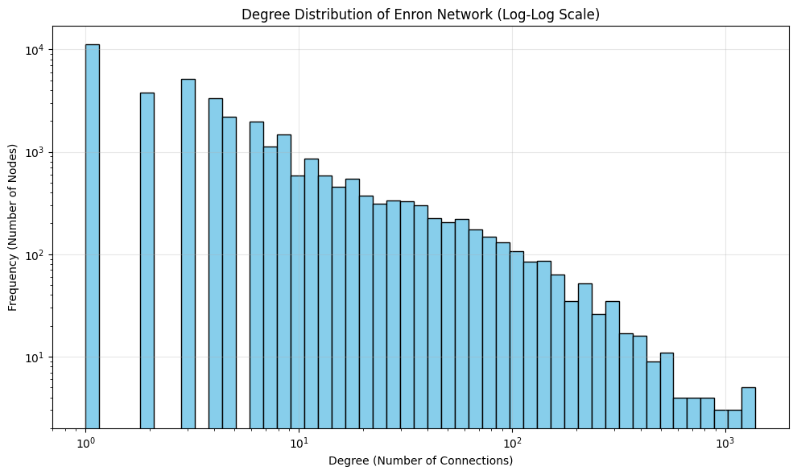
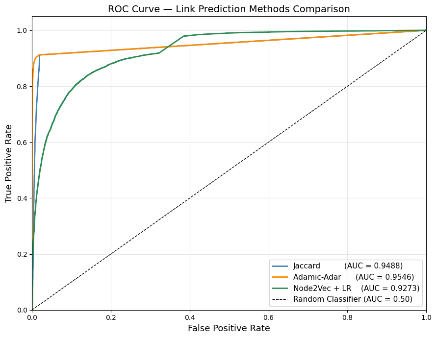
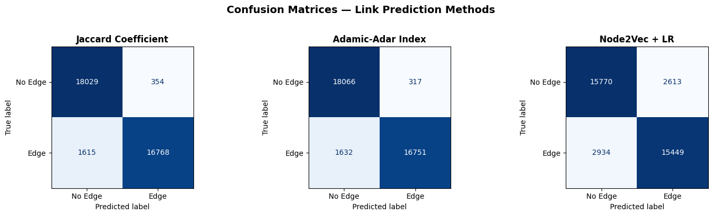

# Enron Email Network - Graph Analysis & Link Prediction

Network analysis and link prediction on the [Enron Email Network](https://snap.stanford.edu/data/email-Enron.html) (Stanford SNAP). The project explores the structure of corporate email communication and compares classical topological heuristics against a representation-learning approach (Node2Vec) for predicting hidden connections between employees.

## Overview

- **Domain:** People Analytics / Social Network Analysis
- **Dataset:** 36,692 nodes (email addresses), 183,831 edges (undirected, unweighted)
- **Task:** Given a partially observed graph, predict which pairs of employees are connected (binary edge classification)
- **Methods compared:** Jaccard Coefficient, Adamic-Adar Index, Node2Vec embeddings + Logistic Regression

## Key results

| Method | AUC | Precision | Recall | F1-Score |
|---|---|---|---|---|
| **Adamic-Adar Index** | **0.9546** | 0.9814 | 0.9112 | **0.9450** |
| Jaccard Coefficient | 0.9488 | 0.9793 | 0.9121 | 0.9445 |
| Node2Vec + Logistic Regression | 0.9273 | 0.8553 | 0.8403 | 0.8478 |

The classical neighborhood-based heuristics (Adamic-Adar, Jaccard) outperform Node2Vec on this network. This is consistent with the graph's structure: a high clustering coefficient (0.50) indicates communication happens largely within tight-knit, closed groups - a regime where "shared neighbors" is an almost perfect predictive signal. Node2Vec's random-walk embeddings capture broader organizational structure and remain valuable for detecting latent relationships that don't share direct neighbors, but trade off some precision/recall on this particular dataset.

Full write-up, methodology, and discussion of limitations are in [`report/`](report/).

### Degree distribution (power-law / scale-free structure)


### ROC curve comparison


### Confusion matrices


## Methodology

1. **Exploratory Network Analysis** - connected components, clustering coefficient, triangle count, transitivity, degree centrality / betweenness / eigenvector / closeness centrality, degree distribution
2. **Train/test split** - 10% of real edges held out as positive test samples; equal number of random non-edges sampled as negatives (balanced dataset)
3. **Classical link prediction** - Jaccard Coefficient and Adamic-Adar Index computed directly on the training graph
4. **Representation learning** - Node2Vec (via [PecanPy](https://github.com/krishnanlab/PecanPy) for efficient random walks) generates 128-dim node embeddings; edge features built via Hadamard product; classified with Logistic Regression. Grid search over walk strategies (p, q) — best strategy: High Exploration (p=0.1, q=0.1)
5. **Evaluation** - AUC, Precision, Recall, F1, ROC curves, confusion matrices, train/test overfitting check, DeLong's test for statistical significance between strategies

## Repository structure

```
enron-link-prediction/
├── README.md
├── LICENSE                     # MIT license (applies to code, not to report.pdf)
├── requirements.txt
├── notebooks/
│   └── graphs_final.ipynb      # full analysis pipeline
├── report/
│   └── report.pdf              # detailed written report (methodology, results, discussion)
├── results/
│   ├── comparison_table.csv
│   └── figures/                # exported plots from the notebook
└── .gitignore
```

## Data

This repository does **not** include the raw dataset. Download it directly from Stanford SNAP:

```
https://snap.stanford.edu/data/email-Enron.html
```

Place the extracted `email-Enron.txt` file in a local `data/` folder before running the notebook (this folder is gitignored).

## Running it

```bash
pip install -r requirements.txt
jupyter notebook notebooks/graphs_final.ipynb
```

> Note: the Node2Vec embedding generation step (**Step 8a** - grid search over random-walk strategies) takes ~78 minutes on a standard machine and must run once to produce the `.npy` embedding files consumed by the rest of the pipeline. These files are not committed to the repo (see `.gitignore`) since they're large, regenerable artifacts. On a first run, execute Step 8a before moving on to Step 8b; on any subsequent run, Step 8a can be skipped as long as the `.npy` files it produced are still present locally.

## Tools

Python · NetworkX · PecanPy · Gensim (Word2Vec) · scikit-learn · Matplotlib · Seaborn

## Author

MSc project - Information Systems & Services, University of Piraeus, 2026.

## References

- Grover, A., & Leskovec, J. (2016). *node2vec: Scalable feature learning for networks.* KDD 2016.
- Stanford Network Analysis Project - [Enron email network](https://snap.stanford.edu/data/email-Enron.html)
